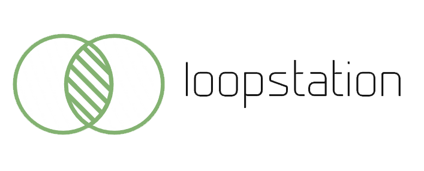
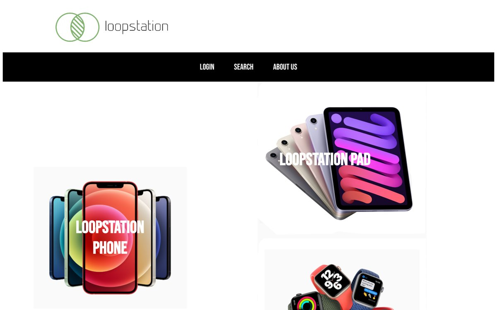
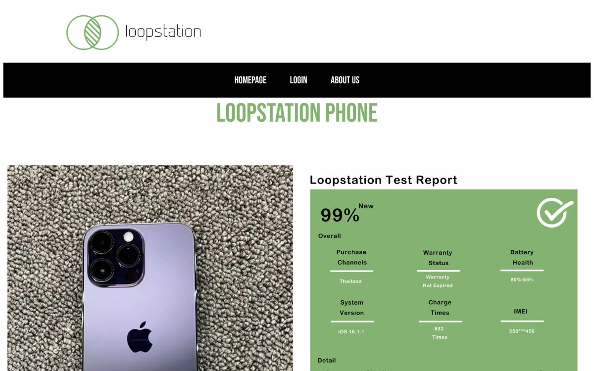
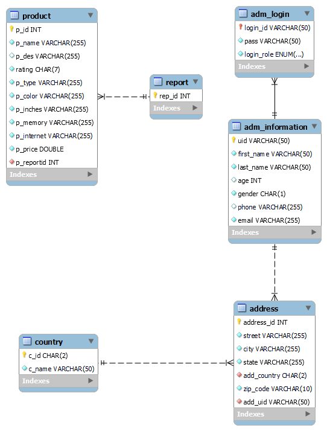

<div align="center">



# Loopstation

**二手数码回收交易平台 · Second-hand trading platform for phones, tablets and wearables**

`HTML / CSS / JavaScript` · `Node.js` · `Express` · `MySQL`

</div>

Loopstation 是一个面向二手手机、平板和智能穿戴设备的回收交易网站。用户可以浏览和搜索商品、查看每台设备的检测报告；管理员登录后可以管理商品和管理员账号。

Loopstation is a web platform for buying and selling used phones, tablets and wearables. Visitors browse and search listings and view a test report for each device; administrators sign in to manage products and admin accounts.

<p align="center">
  
  
</p>

## 功能 · Features

| 模块 | 说明 |
|---|---|
| 首页 | 按手机、平板、穿戴设备三大品类展示商品 |
| 商品搜索 | 按商品名称和类型搜索商品 |
| 商品详情 | 展示设备图片、成色、电池健康、保修状态、充电次数等检测报告 |
| 汇率换算 | 调用 Fixer API，在页面上切换不同货币显示价格 |
| 管理员登录 | 账号登录，区分 Boss、Product Manager、Tester 三种角色 |
| 商品管理 | 商品的新增、编辑、删除与查询（增删改查） |
| 管理员管理 | 管理员账号的新增、编辑、删除与搜索 |

## 技术架构 · Architecture

```text
浏览器 Browser
   │
   ▼
frontend/  Express 静态页面服务 (port 3031)
   │        HTML + CSS + 原生 JavaScript (fetch)
   ▼
backend/   Express REST API (port 5000)
   │
   ▼
MySQL      lsdb 数据库（6 张表）
```

**后端接口 · REST API**

| 方法 | 路径 | 用途 |
|---|---|---|
| `POST` | `/search` | 按条件搜索商品 |
| `POST` | `/api/product` | 新增商品 |
| `PUT` | `/api/product/:id` | 修改商品 |
| `DELETE` | `/api/product/:id` | 删除商品 |
| `GET` | `/api/productdetail/:id` | 商品详情 |
| `POST` | `/login` | 管理员登录 |
| `GET` | `/admis` | 管理员列表 |
| `POST` | `/searchAdmi` | 搜索管理员 |
| `POST` | `/admi` | 新增管理员 |
| `PUT` | `/admi/:id` | 修改管理员 |
| `DELETE` | `/admi/:id` | 删除管理员 |

**数据库设计 · Database**

6 张表：`product`、`report`、`adm_login`、`adm_information`、`address`、`country`。建表脚本见 [`app/backend/lsdb.sql`](app/backend/lsdb.sql)。

<p align="center"></p>

## 本地运行 · Run locally

需要 Node.js 和 MySQL 8。Requires Node.js and MySQL 8.

```bash
git clone https://github.com/Codooooooo/Loopstation.git
cd Loopstation/app

# 1. 安装依赖 Install dependencies
npm install
npm install --prefix backend
npm install --prefix frontend

# 2. 建库 Create the database (e.g. in MySQL Workbench or the mysql CLI)
mysql -u root -p < backend/lsdb.sql

# 3. 配置数据库连接 Configure the connection
cp backend/.env.example backend/.env   # 填入你的 MySQL 账号密码

# 4. 同时启动前后端 Start frontend and backend together
npm start
```

启动后访问 http://localhost:3031 。Then open http://localhost:3031.

## 团队与分工 · Team

| 成员 | 负责内容 |
|---|---|
| **Chusong Xu** | 首页、商品详情、关于我们页面；商品搜索；商品增删改查；数据库设计与建库；前后端接口对接 |
| Lingrui Dong | 商品管理页、账号管理页、登录页；登录功能；管理员搜索与增删改查；前后端接口对接 |
| Yunduo Luo | 搜索页、商品详情、页面导航设计；汇率换算 API；前后端接口对接 |

## 素材与致谢 · Credits

- 汇率数据：[Fixer API](https://fixer.io/)
- 字体：[Bebas Neue](https://fonts.google.com/specimen/Bebas+Neue)（Google Fonts）
- 产品图片来自 Apple 官网，仅用于学习演示，版权归 Apple 所有。Product images are from apple.com and are used for demonstration only.
